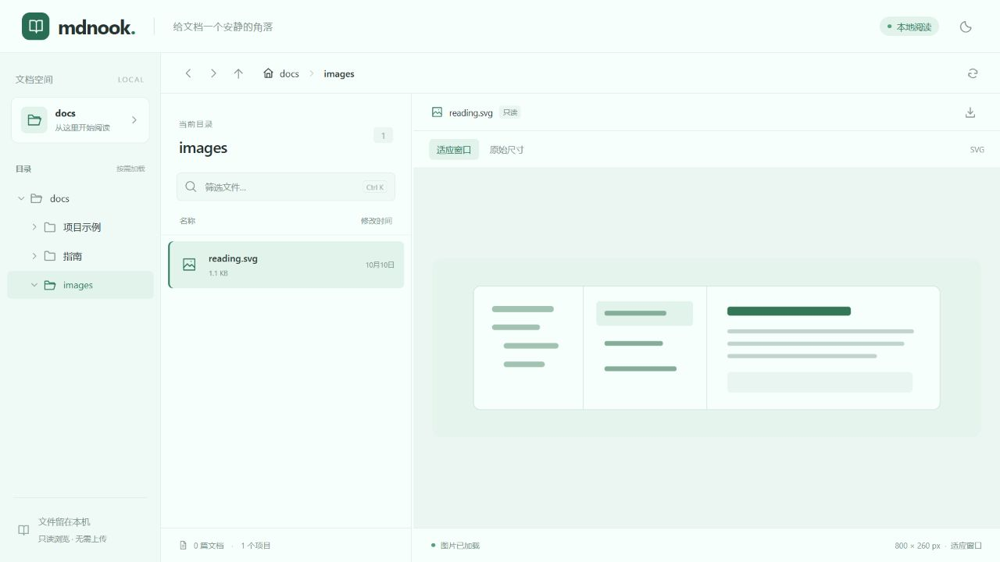
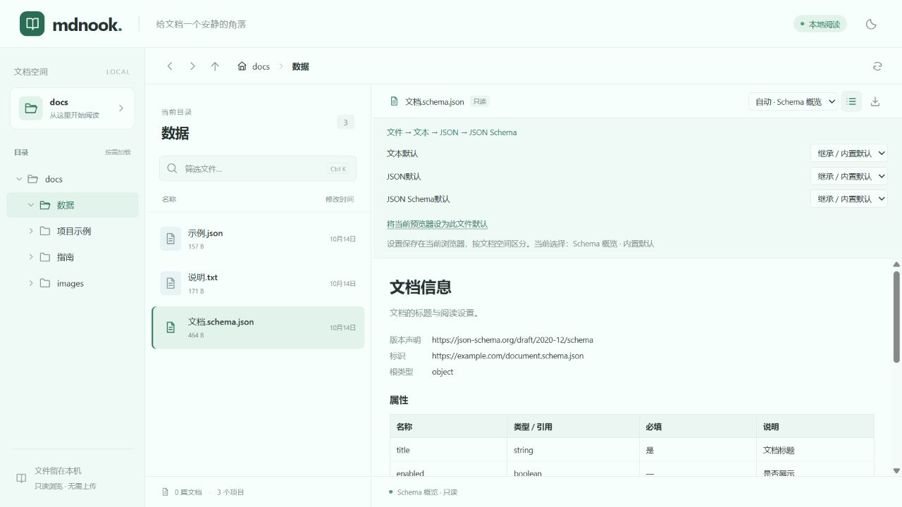
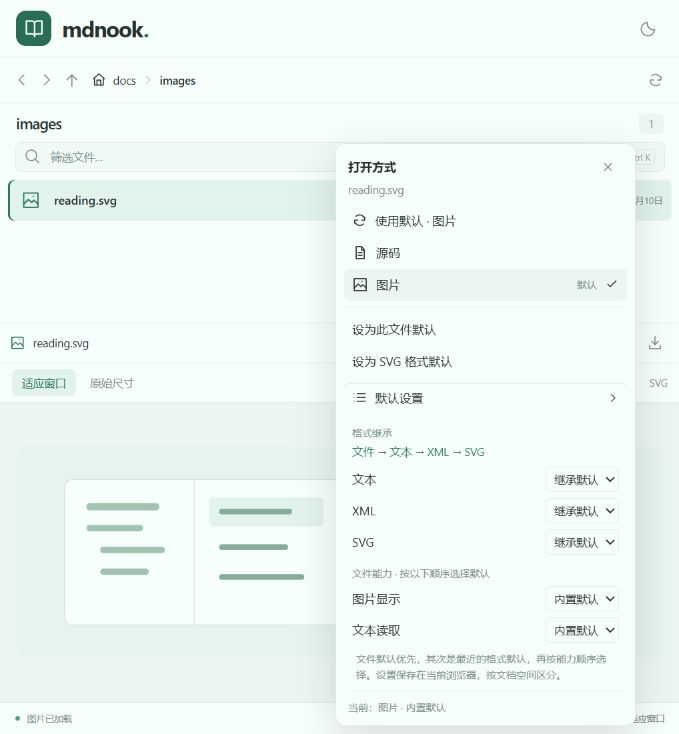

# mdnook 0.0.1 验收记录

## 2026-10-14 0.0.3 发布准备

- workspace、CLI 与开发显示版本同步为 `0.0.3`，README 安装示例和变更记录同步更新。
- `pnpm release:dry-run` 通过：类型检查、56 项测试、生产构建、`mdnook-0.0.3.tgz` 打包、独立安装和 npm 上传预览；本地预演没有上传 npm。
- `node scripts/check-release-tag.mjs v0.0.3` 通过。正式发布由推送 `v0.0.3` 标签触发仓库现有 GitHub Actions 工作流。
- GitHub 发布工作流已完成 npm 上传和 registry 完整性校验。首次 CI 的 Node 24 通过，Node 22.12 在构建 Vite 配置时加载 workspace `.ts` 文件失败；随后将开发 API 改为只在开发模式经 `tsx` 加载。
- 修复后 `pnpm check` 再次通过。本机 Node 22.18 关闭原生 TypeScript 后，真实 Vite 开发入口保持回环正文 200、非回环正文 401，生产构建与 `mdnook-0.0.3.tgz` 独立安装验证通过；Node 22.12 的 Windows / Ubuntu 验证由后续 CI 执行。

## 2026-10-14 开发服务认证与显式免认证参数

- 开发 Vite 继续默认监听 `0.0.0.0:5173`，API 直接使用原始请求 socket，移除回环代理；默认回环免登录、远程未登录拒绝文档访问。增加开发和 CLI 的 `--no-auth`，控制台、会话元数据及页面显示免认证模式。
- `pnpm check` 通过：类型检查、56 项测试、生产构建。真实 Vite 配置覆盖回环放行、非回环 API 返回 401、伪造转发头不能绕过、`/@fs/` 不能读取示例文档、远程 HTTP 禁止密码登录、显式关闭认证与根目录限制。
- 真实 Vite HTTPS socket 使用注入认证器验证登录、cookie 读取、退出与撤销；开发参数测试覆盖默认地址、端口、TLS 参数配对和显式免认证。测试证书只用于回归测试。
- 启动实际 `pnpm dev` 后，通过 `http://127.0.0.1:5173` 请求会话为 `loopback`、正文 200；通过 `http://192.168.0.57:5173` 请求会话为未认证的 `system`、正文 401。请求从本机经非回环接口发起，未在另一台设备上实测。
- 更新本地安装包并通过 `pnpm pack:check`：帮助包含 `--no-auth`，独立包在全接口 HTTP 监听时返回 `mode: disabled`，文档、前端资源及停止后的端口释放通过。验证使用独立空闲端口，避免命中现有开发服务。
- 内置浏览器打开局域网开发页面时超时，本轮没有取得真实开发页面 UI 证据。真实系统账号密码成功登录、外部设备证书信任和 Linux / macOS PAM 仍未实测。

## 2026-10-14 系统账号认证与回环免登录

- 最终认证/服务端专项运行 `pnpm exec tsx --test tests/auth.test.ts tests/server.test.ts`：21 项通过。随后补充的真实 HTTPS 登录、cookie 访问、退出和撤销链路也在全量运行中通过；认证 13 项、服务端 8 项均通过。
- 基于真实 socket 的回归覆盖 IPv4 / IPv6 回环、IPv4 映射、非回环来源、缺少连接信息、伪造 Host / 转发头、全部文档与下载 API、HTTPS 要求、同源与跨站检查、限流、并发认证、过期、伪造会话、重新登录轮换、退出与重启失效。
- Windows 原生辅助程序实际加载，并拒绝无关本地账号。系统账号密码成功登录和失败密码验证未实测；测试中使用注入认证器验证成功/失败流程。Linux / macOS PAM 未实测。
- 最终 `pnpm typecheck`、`pnpm test`（51 项）、`pnpm build` 与 `pnpm pack:check` 通过。检查期间工作树的预览器模块并发更新曾产生中间态失败；对应测试更新后全量通过。认证修改没有改那些预览器测试或实现。
- 本地 npm 包独立安装验证包括新 `--host` / `--tls-cert` 帮助、非回环未配置 TLS 拒绝启动、证书与私钥必须成对、命令入口、文档 API、SPA 资源及退出后端口释放。
- 最新生产前端通过内置浏览器验证：未登录显示登录页，模拟错误密码显示统一提示且立即清空密码；模拟正确账号登录后恢复原 Markdown 深链接，正文正常显示；刷新保留会话，退出移除文档空间并回到登录页。真实回环访问无需输入账号密码，正文正常显示。
- 登录 UI 使用仅绑定回环地址的临时测试服务，模拟非回环 TLS 连接信息和账号；浏览器测试不代表真实系统密码登录，也不代表外部设备的证书信任验证。测试服务在验证后关闭。

日期：2026-10-10。环境：Windows、Node.js 26.7.0、pnpm 10.28.1；浏览器为 Codex 内置 Chromium 页面。

## 已通过

- `pnpm typecheck`：四个包的 TypeScript / Vue 类型检查。
- `pnpm test`：9 项测试覆盖跨平台路径、中文与 URL 编码、越界拒绝、真实 Windows junction、文件类型与大小限制、附件、SPA 深链接、真实监听端口冲突及关闭。
- `pnpm dev fixtures/docs`：Vite 5173、独立 API 8787；真实页面通过代理读取文档。按 Ctrl+C 停止后两个端口均关闭。
- `pnpm pack:cli`：生产前端构建与 CLI 打包；生成 `artifacts/mdnook-0.0.1.tgz`，包中仅包含 CLI、前端资源、运行时依赖声明、说明文件及更新记录。
- `pnpm pack:check`：在独立临时目录以 npm 仅安装生产依赖、不执行安装脚本，验证版本、帮助、非法端口、不存在的目录、中文含空格的根目录、API、页面深链接、静态资源和停止后端口释放。发布产物没有私有 workspace 包的运行时依赖。

## 真实页面交互

以下为首轮实现的页面交互记录；本次版本提交重新执行类型检查、9 项自动测试、构建和独立安装包检查。

- 目录树、当前目录文件列表和 Markdown 预览同时显示，跳转后同步高亮。
- Markdown 相对链接跨目录跳转、目录 README 自动预览、中文与带空格文件。
- 含 `%` 和 `#` 的文件名只解码一次，能从 Markdown 链接正常打开。
- 重复标题生成 `下一步`、`下一步-1`；锚点点击触发阅读区滚动。
- 本地 SVG 图片实际加载，`naturalWidth = 800`。
- 缺失文档与越界链接显示错误提示，并保留当前文档。
- 文件名筛选、Ctrl+K 聚焦、键盘调整分隔线、深浅主题。
- 浏览器前进、后退、刷新恢复当前文档。
- 390 × 844 窄屏中列表和预览同时可见，页面横向宽度为 390；标题目录能作为侧面板打开。
- 最终页面与开发页面的浏览器 console 无 error / warn。

## 验证边界

最低声明版本为 Node.js 22.12；其依赖的 engines 与此匹配，但本次未在 Node.js 22 / 24、Linux 或 macOS 上运行。

默认浏览器自动打开分支已实际调用，未报告启动失败；系统浏览器不在当前浏览器工具的可观察范围内，因此未将其页面显示计入 UI 验收。生产界面通过独立 CLI 服务和内置浏览器验证。

测试运行器在 Windows 沙箱内曾遇到 `uv_os_get_passwd` 失败；CLI / Vite 曾遇到依赖文件读取 `EPERM`。这些命令经允许在沙箱外运行后通过，未修改系统配置。

本次生成了安装包，没有执行 npm publish。首版通过手动刷新读取变化；全文搜索、文件监听、Mermaid 和数学公式留待后续。

## 页面截图

## GitHub Actions 配置验证

- 新增 `ci.yml`：分支更新 / PR 的 Windows、Ubuntu 与 Node.js 22.12 / 24 检查矩阵。
- 新增 `publish.yml`：`vX.X.X` 标签触发构建、安装验证、npm 发布、registry 版本与 SHA-512 核对。
- actionlint 1.7.12：两个工作流的语法及 GitHub Actions 配置校验通过。
- 本地 `pnpm release:dry-run` 通过：类型检查、12 项测试、构建、独立 npm 安装和发布预览。其中 3 项新增测试覆盖标签版本不一致、不可发布的包、同版本产物冲突，以及 registry 的 404 / 401 / 500 区分。
- 本次没有创建新版本标签，也没有上传 npm 包。npm 凭据或 Trusted Publisher 的授权需要由维护者配置；本地预览不能验证 GitHub OIDC 和 npm 发布权限。

## 0.0.2 发布准备

- `pnpm release:tag-check v0.0.2` 通过，全部 workspace 包及运行界面版本统一为 `0.0.2`。
- 类型检查、12 项测试、生产构建、`mdnook-0.0.2.tgz` 独立安装与发布预览通过。
- 修改后的工作流通过 actionlint 校验；发布步骤通过 OIDC 获取身份，不读取 `NPM_TOKEN`。
- 此处记录本地发布前验证；实际 npm 发布及 Trusted Publisher 首次验证以 `v0.0.2` 的 GitHub Actions 发布运行结果为准。

## 0.0.2 OIDC 发布与 registry 延迟

- 发布运行：<https://github.com/oft/mdnook/actions/runs/38049446042>。npm 接受上传并签署 provenance；发布后提示需要几分钟处理，最初约 1 分钟的 metadata 检查等待不足。
- 已从公开 registry 确认 `mdnook@0.0.2`、`latest = 0.0.2`，并确认发布身份包含 GitHub Trusted Publisher。
- 下载原发布运行的 CI 安装包，确认 SHA-512 与 registry 中的安装包完全一致；对应提交的 Linux / Windows、Node 22.12 / 24 四组 CI 均通过。
- 发布后的校验等待窗口延长到 10 分钟；新增延迟可用、校验值冲突和处理超时的回归测试。重跑保存安装包时允许替换同名 artifact。
- CI 修复后的 14 项测试、脚本语法检查和 actionlint 校验均通过。

## 2026-10-14 分级预览器与图片预览

- `pnpm check` 通过：类型检查、15 项测试、生产构建。Windows 沙箱内的依赖读取曾导致类型检查报错；在允许的环境中重新运行后全部通过，未为沙箱错误修改产品代码。
- 初版从 `App.vue` 拆出预览宿主和 Markdown 预览器，使用文件与图片两级注册表；该注册方式现已由下节的统一递归树替代。
- 使用构建后的 CLI 和内置浏览器实际验证 SVG、JPEG、PNG 图片解码；SVG 为 800 × 260，JPEG 为 1280 × 720，PNG 为 1 × 1。PNG 文件名包含中文、空格、`#`、`%`，预览和明确下载均通过。
- 适应窗口模式下图片缩小到预览区域；SVG 原始尺寸模式显示宽度为 800，并出现区域内横向滚动。浏览器前进、后退、刷新能够恢复当前图片。
- Markdown 直接深链接、标题锚点、跨目录链接、图片链接均通过；缺失文档显示提示并保留当前文档。
- TIFF 占位文件验证的是图片分类和未支持提示，未执行 TIFF 解码。无效 PNG 数据验证加载失败提示；未知 TXT 文件由通用宿主提供未支持提示和下载入口。
- 390 × 844 窄屏中图片显示宽度为 358，页面横向宽度为 390，没有页面横向溢出。
- API 回归覆盖图片链接到预览页面的跳转、生产 `/file` 深链接、明确下载、编码文件名、SVG sandbox 和越界路径拒绝。

验证边界：本次浏览器实测仅包含 SVG、JPEG、PNG；其他已登记的浏览器图片格式未逐一实测。图片族识别与当前可显示格式独立，TIFF、HEIC 等保留未支持提示。文本、代码、PDF 和音视频预览器尚未接入。

## 2026-10-14 统一递归树与按需加载

- `pnpm check` 通过：类型检查、21 项测试、生产构建。新增节点协议测试覆盖四层递归、文件信息及处理结果继承、异步匹配和子树、按需加载、兜底、取消、模块失败重试、模块复用、循环检测及响应式参数合并。
- 根文件节点通过 `/api/file` 读取公共元数据，再逐级传入统一上下文。接口测试覆盖中文及特殊字符文件名、大小、时间、MIME、资源地址、目录拒绝、缺失文件、越界和 Windows junction；不暴露本机绝对路径。
- 生产构建把文件、Markdown、图片、SVG、位图与兜底组件拆成独立模块。内置浏览器的实际网络请求确认：SVG 页面只加载文件、图片、SVG 和共用图片模块，没有加载 Markdown、位图或兜底模块；文件元数据仅请求一次。
- 图片“原始尺寸”通过父级上下文影响 SVG 子级，实际显示宽度为 800；切换显示方式没有产生新请求。Markdown 锚点变化只请求链接解析，没有重新读取元数据或正文。
- 实际页面验证 SVG、PNG、JPEG、图片兜底、文件兜底、损坏图片错误状态、Markdown 图片链接、缺失链接提示以及前进后退。将损坏 PNG 替换为有效内容后点击重试，恢复为 1 × 1 图片；控制台没有错误或警告。
- 最终构建在 390 × 844 视口显示图片宽度为 358，页面及滚动宽度均为 390，无页面横向溢出。截图已更新为递归树实现后的示例目录页面。

与前节相同，TIFF 仅使用占位文件验证兜底，未验证解码；其余浏览器图片格式没有逐一实测。元数据中的 MIME 根据扩展名推断。

## 2026-10-14 节点模块分散与逐级加载

- 移除集中注册表。入口只导入文件根节点；文件、Markdown、图片、具体格式和兜底定义分别放在所属模块中，父级仅保存直接子级的轻量匹配与 `loadNode()` 入口。
- `pnpm check` 通过：类型检查、25 项测试及生产构建。新增验证覆盖节点定义加载失败重试、成功定义复用但重新处理当前文件、加载期间取消、不同入口指向祖先的循环、入口与定义标识一致以及兜底定义延迟加载。
- 实际网络请求确认 SVG 页面仅加载图片节点定义、SVG 节点定义及对应组件；Markdown、位图和两种兜底定义没有加载。文件元数据只请求一次，切换原始尺寸没有新增请求。
- 真实页面验证 SVG 原始尺寸 800、特殊文件名 PNG 1 × 1、图片兜底、文件兜底、Markdown 图片链接及后退恢复；控制台没有错误或警告。TIFF 仍仅验证未支持提示，不包含解码验证。

## 2026-10-14 文件类型树与默认预览器

- 独立类型树接入 `file → text → json → json-schema`、Markdown 和图片分支。每个模块只管理直接子级，类型识别器、预览器定义和视图分别按需加载。
- `pnpm check` 通过：类型检查、34 项测试及生产构建。新增覆盖实际类型链、父级处理结果复用、默认选择优先级、兼容性、无效配置、JSON 错误保留、Schema 识别约定、导入重试、循环、取消和文本 API 边界。
- 文本 API 验证中文及 `#` / `%` 编码文件名、UTF-8 BOM、SVG 源文本、无效 UTF-8、NUL、未知格式、10 MiB 上限、越界路径与 Windows junction。根目录设置标识在重复初始化时保持稳定，同名但不同位置的目录使用不同标识。
- 实际页面验证 Schema 概览的版本声明、属性、必填信息与完整结构；JSON 嵌套展开；UTF-8 文本；Markdown 正文、标题目录；SVG 800 × 260 图片与源码切换。控制台没有错误或警告。
- 实际页面验证类型继承：Schema 未配置时使用 JSON 的用户默认，JSON 未配置时继续继承文本；Schema 显式配置覆盖父级；单个文件配置优先于类型，刷新后恢复；清除配置逐级恢复继承与内置默认。测试设置已通过页面清除。
- 网络请求确认普通 JSON 每个文件会话只读取一次元数据和文本，切换预览器没有重复读取；SVG 首次图片预览没有请求文本，首次切换源码后只读取一次，反复切换复用结果。图片页面没有加载位图和图片兜底模块，Markdown 模块在首次进入 Markdown 时才加载。

验证边界：Schema 仅预览结构，不包含合法性验证、表单生成和远程引用加载。类型识别基于格式提示与已解析内容的约定，不代表完整文件格式鉴定；其他图片格式的解码验证沿用前节边界。

## 2026-10-14 格式能力组合与打开方式

- `pnpm check` 通过：类型检查、51 项测试和生产构建。预览器相关新增测试覆盖 SVG 双能力、默认配置冲突、格式 / 文件 / 手动选择优先级、v1 到 v2 迁移、组合能力约束、文本读取失败后的图片选择，以及文本缓存、重试和取消。
- 格式树调整为 `文本 → XML → SVG`，SVG 继承文本能力并组合图片能力；PNG / JPEG 等在位图下有具体格式节点，可以分别配置默认。源码预览器只要求文本能力，不再枚举 SVG。文本能力声明本身不触发读取。
- 构建后的独立 CLI 服务与内置浏览器验证：工具栏、选中及未选中文件的右键、Shift+F10 打开相同菜单；Esc 关闭并恢复焦点，点击外部关闭。菜单标记默认，能手动选择、恢复默认、保存和清除文件 / 格式关联。
- SVG 实际显示为 800 × 260。刷新后保留 SVG 格式默认与文件默认；文件默认覆盖 XML 格式默认，XML 格式默认覆盖能力默认。仅配置文本能力时可使用源码；图片与文本能力同时配置时按 SVG 的 `image → text` 顺序选择图片。验证用配置已通过页面清除。
- 网络请求确认：SVG 图片识别没有文本请求；首次选择源码时读取文本并加载源码组件；同一会话反复切换图片 / 源码没有新增请求。JSON Schema 仍可使用概览、JSON 树与源码，普通 JSON 正常展开。Markdown 正文和默认选择通过页面回归，控制台无错误或警告。
- 当前 679 × 734 页面中菜单宽 300，展开设置后位于视口内；页面滚动宽度为 679，没有横向溢出。旧的右键请求消费后，返回文件不会自动重开菜单。

验证边界：设置迁移及读取失败后图片仍可选择由协议测试验证；本轮浏览器实测图片为已有 SVG，其他图片解码范围沿用前节。打开方式只接入内置只读预览器，未调用外部应用。

